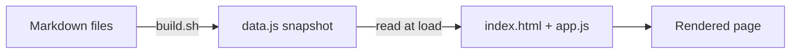
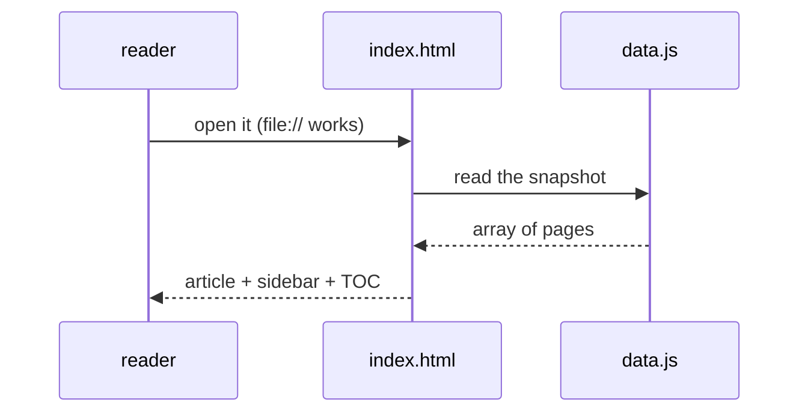
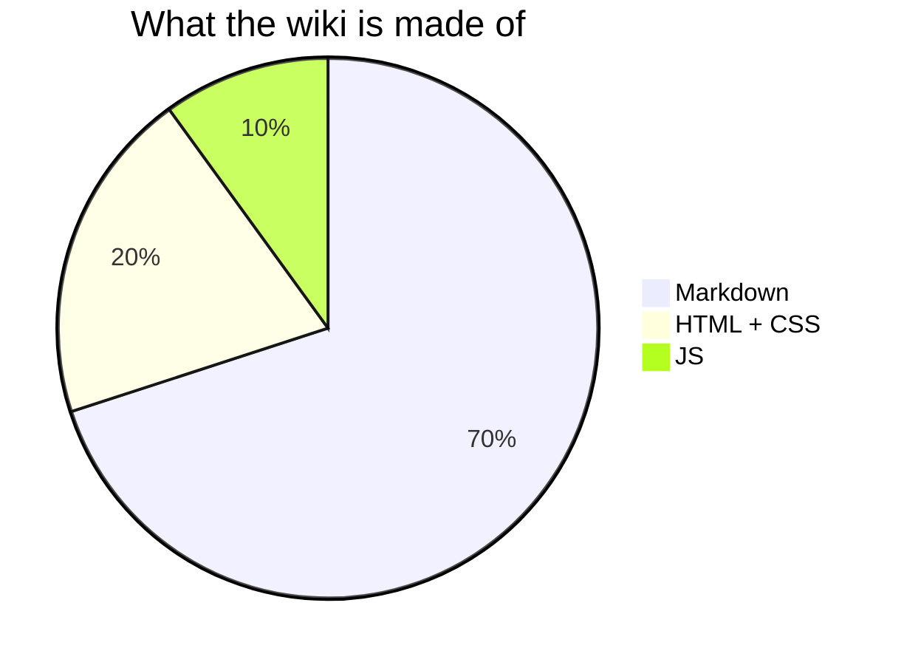

# Advanced

The deep end of the sample wiki: every link form, every math delimiter,
more diagram types, footnote tricks, and the raw HTML escape hatch.
Like [[Formatting]], each section shows the **source first**, then the
same text rendered live. Containers, alerts, tabs and badges are
documented on [[Formatting]] and not repeated here.

## Links, all three forms

**Wiki link, stem form** — any file name works from any folder,
case-insensitively; the alias after the pipe sets the link text. When
two files share a name, the shallower one wins.

```markdown
[[Basics]] [[Home|welcome home]] [[2026-Plan]]
```

[[Basics]] [[Home|welcome home]] [[2026-Plan]]

**Wiki link, path form** — a slash makes the target an exact path from
the articles root, case-sensitive, no `..` traversal. Broken links are
marked, never silently dropped:

```markdown
[[Guides/Formatting]] [[Guides/Nope]]
```

[[Guides/Formatting]] [[Guides/Nope]]

**Plain Markdown link** — relative to *this file's* folder; it needs the
`.md` suffix to be caught. `./` and `../` steps work, directories alone
do not; a leading slash is root-absolute:

```markdown
[2026 Plan](../Notes/2026-Plan.md) [the home article](/Home.md)
```

[2026 Plan](../Notes/2026-Plan.md) [the home article](/Home.md)

Every rendered page is also a direct URL — the part after `index.html#`
in the address bar (here, `#Guides/Advanced`) — so you can copy it from
the address bar and paste it anywhere; it opens this exact page.

## Math: all three delimiters

Inline math uses dollar signs, or escaped parens — which are safer when
the sentence also contains money: the dollar form pairs up greedily, so
a stray "$5 and $10" in prose can swallow the words between the signs.

```markdown
Inline math uses dollar signs — $e^{i\pi} + 1 = 0$ — or escaped
parens: \(e^{i\pi}+1=0\).
```

Inline math uses dollar signs — $e^{i\pi} + 1 = 0$ — or escaped
parens: \(e^{i\pi}+1=0\).

Display math goes on its own lines, fenced by double dollars:

````markdown
$$
\begin{aligned}
\sum_{n=1}^{\infty} \frac{1}{n^2} &= \frac{\pi^2}{6} \\[6pt]
\int_0^\infty e^{-x^2}\,dx &= \frac{\sqrt{\pi}}{2}
\end{aligned}
$$
````

$$
\begin{aligned}
\sum_{n=1}^{\infty} \frac{1}{n^2} &= \frac{\pi^2}{6} \\[6pt]
\int_0^\infty e^{-x^2}\,dx &= \frac{\sqrt{\pi}}{2}
\end{aligned}
$$

### What KaTeX takes

Full KaTeX is available: cases, matrices, text labels —

```markdown
$$ P(X=k)=\begin{cases}\tfrac12 & k=0\\[2pt] \tfrac12 & k=1\end{cases} $$
```

$$
P(X=k)=\begin{cases}\tfrac12 & k=0\\[2pt] \tfrac12 & k=1\end{cases}
\qquad
\begin{pmatrix} 1 & 0 \\ 0 & -1 \end{pmatrix}
\qquad
\mu_{\text{sample}} = \frac1n\sum_{i=1}^{n} x_i
$$

Broken TeX is never fatal — it prints red instead of killing the page.
Math inside code spans and code blocks is left alone: `$x$` stays text.

## Diagrams

Fence a mermaid block like any code block — three backticks, `mermaid`
as the language. Flow first — this is the wiki in four boxes:

````markdown

````


Sequence diagrams read the other direction:

````markdown

````


And pie charts take simple `label : value` lines:

````markdown

````


## Local images

`` with a relative path: the path resolves **against the page's folder**,
same rule as plain `.md` links. Images are ordinary files that live next to the
articles and load lazily when a page shows them — `data.js` stays text-only, so a
big image costs nothing until you actually open its page. Supported: `png` `jpg`
`gif` `svg` `webp`.

```markdown

```


The file sits next to this article: `articles/Guides/logo-demo.svg`. If the path
does not match a file, the browser shows the alt text instead.

## Local HTML files

A link ending in `.html` or `.htm` is treated as a **file next to the articles**,
not a wiki page: same path rule as images, but it opens in a **new tab** (📄) —
it leaves the wiki frame, with its own styles and scripts. Not indexed: no
sidebar entry, no search, no backlinks.

```markdown
[Demo report](report-demo.html) → [Demo report](report-demo.html)
```

Live: [Demo report](report-demo.html)

Not a wiki page on purpose — generated reports and saved pages stay simple files.

## Files outside `articles/` (`file://`)

Images and links may use an absolute `file:///…` URI — **three slashes**: `file://name`
is parsed as a hostname, not a path. How it behaves depends on how *the wiki itself*
was opened, and no app can change that:

- opened directly (`file://`): images paint, links open in a new tab — including
  `file:///path/to/another-wiki/index.html#SomePage`, which opens a **whole other
  wiki, rendered**, or a link to an out-of-KB HTML report
- served over `http(s)`: the browser **blocks every `file:` reference** — the image
  falls back to its alt text, the link refuses to open. Web security, not a wiki limit
- a `file:///…md` link is never rendered: browsers have no markdown renderer, you get
  raw text. For a real wiki page the file must live under `articles/`

Supported image formats: in bundled mode the wiki filters nothing — the browser
paints `jpg` `png` `svg` `webp` `gif` and any other format it supports. Live-render
mode scans the picked folder for the extensions listed by `imageExts` in `config.js`
(png jpg jpeg gif svg webp by default).

## Footnote tricks

References sit in the sentence, definitions at the bottom of the file.
Cite the same id as often as you like — every citation reuses the same
number instead of adding a duplicate. A definition spans several lines
when continuation lines are indented, and its text is Markdown itself:

```markdown
Two claims get footnotes here,[^trick] and the same one is cited
again right here.[^trick]

[^trick]: Cite the same id as often as you like; every citation points
  to the same numbered entry at the bottom. Note this definition itself
  spans two lines: continuation lines are indented two spaces.
```

Two claims get footnotes here,[^trick] and the same one is cited
again right here.[^trick]

[^trick]: Cite the same id as often as you like; every citation points
  to the same numbered entry at the bottom. Note this definition itself
  spans two lines: continuation lines are indented two spaces.

## Raw HTML and bare URLs

HTML passes through untouched, so you can reach for what Markdown lacks.
A bare URL in the text is auto-linked and opens in a new tab, so the
wiki stays where you left it:

```html
press <kbd>Ctrl</kbd>+<kbd>F</kbd> to search a page

<details>
<summary>What the snapshot really is (click to fold)</summary>

`data.js` is a plain JavaScript array of `{slug, mtime, content}`
records with the Markdown base64-encoded.

</details>

A bare URL — https://example.com — is auto-linked.
```

press <kbd>Ctrl</kbd>+<kbd>F</kbd> to search a page

<details>
<summary>What the snapshot really is (click to fold)</summary>

`data.js` is a plain JavaScript array of `{slug, mtime, content}`
records with the Markdown base64-encoded.

</details>

A bare URL — https://example.com — is auto-linked.

## Rebuilding stays honest

```bash
./build.sh    # Linux / macOS — pure bash, offline
build.bat     # Windows — double-click, offline
./build.ps1   # PowerShell (Windows, or pwsh anywhere) — offline
```

```markdown
> [!WARNING]
> Rebuilding **overwrites** `data.js`. Keep it in version control and
> rebuild after every change to the articles.
```

> [!WARNING]
> Rebuilding **overwrites** `data.js`. Keep it in version control and
> rebuild after every change to the articles.

`data.js` is generated — a hand edit there is lost at the next build.
Edit the `.md` files under `articles/` instead; the file's modification
time is what drives the "recent edits" list on the home page. Editing with
**Live render** writes those same files from the browser — when you are done,
run the build once and wikis opened without live render pick the new text up.
The **Bundled** button leaves live render again when you want the snapshot
back. To give readers the live files without an Edit button, set `editButton: false`
in `config.js`.

Back to [[Home]], or revisit [[Basics]] and [[Formatting]].
